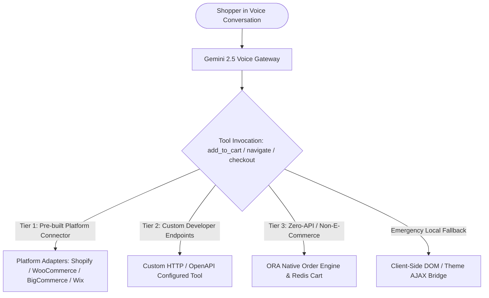

# Tooling, Cart Operations & Multi-Platform Integration Architecture

> **Document Type:** Research Finding, Architectural Analysis & Improvement Blueprint  
> **Status:** Active Architectural Design / Future Roadmap  
> **Category:** Voice AI Tooling, E-Commerce Integration, Cart Synchronization, DOM Operations  

---

## 1. Executive Summary & Problem Statement

ORA is an autonomous, multimodal voice-first sales agent embedded directly on merchant websites. While passive question answering can operate purely on crawled text and vector embeddings, **actionable tools**—specifically `add_to_cart`, `place_order`, `redirect_to_checkout`, and `navigate_to_page`—require deep coordination with the merchant's underlying website and commerce infrastructure.

This document explores the architectural trade-offs, technical feasibility, failure modes, and implementation roadmap for executing store actions across diverse merchant platforms (Shopify, WooCommerce, BigCommerce, Wix, custom headless stacks, and non-e-commerce/zero-API businesses).



---

## 2. Analysis of the Three Tooling Strategies

### Option 1: Dashboard Tool Configuration (Custom Endpoints & Schemas)
* **Concept:** The merchant or developer configures each tool individually in the ORA dashboard by specifying:
  - Target URL / Endpoint
  - HTTP Method (`POST`, `PUT`, `GET`)
  - Request Headers & Authentication Tokens
  - Request Body JSON Schema (with template variables like `{{productId}}`, `{{quantity}}`, `{{variantId}}`)
  - Response Data Path & Error Handling Strategy
* **Pros:** Complete flexibility for custom in-house enterprise backends, custom Next.js/Laravel platforms, and bespoke ERPs.
* **Cons:** High setup friction for non-technical store owners; prone to configuration errors.

---

### Option 2: Pre-built Platform Connectors & SDKs / Plugins (Recommended Standard)
* **Concept:** ORA provides unified platform adapters for standard marketplaces and e-commerce engines:
  - **Shopify:** Uses Storefront GraphQL API (`cartCreate`, `cartLinesAdd`) with Storefront Access Token, plus Admin webhooks.
  - **WooCommerce:** Uses WooCommerce Store API (`/wp-json/wc/store/v1/cart/add-item`) or dedicated ORA WordPress plugin.
  - **BigCommerce:** Uses Storefront Cart REST API (`/api/storefront/carts`).
  - **Wix:** Uses Wix eCommerce Headless SDK (`@wix/ecom`).
  - **ORA Native Backend:** Fallback built-in order engine for zero-API stores.
* **Pros:** 60-second onboarding. Zero manual JSON writing for 95% of merchants. High reliability and deterministic behavior.
* **Cons:** Requires ORA to maintain and version platform-specific connector services.

---

### Option 3: Dynamic Real-Time AI DOM Scraping & Synthetic Invocation
* **Concept:** When a shopper asks to add a product, an AI model or client-side scraper inspects the current webpage DOM, identifies the "Add to Cart" button/form, extracts the underlying action/URL, and executes a synthetic click or AJAX dispatch.
* **Pros:** Requires zero API keys or platform configuration on day one.
* **Cons:** Slow, fragile, and fraught with edge cases as detailed below.

---

## 3. Deep-Dive: The 6 Critical DOM & Voice Agent Corner Cases

Relying purely on dynamic DOM inspection for transactional operations introduces serious production hazards:

### 🛑 Corner Case 1: The "Cross-Page" Problem (User is Not on the Product Page)
* **Scenario:** A shopper is on the Home Page (`/`) or a Category Page (`/collections/shoes`) talking to the voice AI:
  > *"Hey ORA, I like that Black Bomber Jacket you mentioned earlier, add it to my cart."*
* **Problem:** The Bomber Jacket's DOM elements (button, variant IDs, form) **do not exist on the current page**.
* **Implication:** The widget cannot inspect or click a button that isn't in the current DOM. To use DOM clicking, ORA would have to:
  1. Forcefully navigate the customer's browser to `/products/black-bomber-jacket` (disruptive UX).
  2. Or fetch the raw HTML in the background (`fetch('/products/black-bomber-jacket')`), parse it via `DOMParser`, extract the hidden inputs, and submit them.

---

### 🛑 Corner Case 2: Unselected Mandatory Variants (Size, Color, Fit)
* **Scenario:** A shopper says *"Add the jacket to my cart"*, but the jacket comes in `Small`, `Medium`, `Large` and `Black`, `Navy`.
* **Problem:**
  - On most stores, the main "Add to Cart" button is **disabled** until the customer clicks a size swatch.
  - If you blindly trigger the form submission or API without variant selection:
    - It fails with an error (`"Please select a size"`).
    - Or worse, it silently adds the default variant (e.g. `XS - Beige`), leading to incorrect orders and returns.
* **Implication:** The AI agent must first converse with the customer to clarify options (*"What size and color would you prefer?"*) and resolve the specific `variantId`, not just the base `productId`.

---

### 🛑 Corner Case 3: Sub-400ms Voice Latency vs. LLM DOM Scraping Delay
* **Scenario:** During a real-time voice call, Gemini responds in under 400ms to maintain natural conversational pacing.
* **Problem:**
  - An HTML DOM tree can be 50KB–500KB.
  - Sending DOM snippets to an LLM, waiting for reasoning, extracting the button selector, and executing it takes **1.5 to 3 seconds**.
* **Implication:** Using an AI model at runtime to inspect the DOM during a voice turn introduces an awkward 2–3 second silence on the voice call.

---

### 🛑 Corner Case 4: Modern Single-Page Apps & Headless Frameworks (React / Next.js / Vue)
* **Scenario:** The merchant store is built with Next.js, Hydrogen, Remix, or Vue.
* **Problem:**
  - Modern frameworks do not use traditional HTML forms (`<form action="/cart/add">`).
  - Instead, the button has a React synthetic event handler: `<button onClick={() => dispatch(addToCart(item))}>`.
  - In React 18+, event handlers are attached at the root document level, not directly on the DOM element. An external script cannot extract the internal JS function closure from the DOM.
  - Synthetic clicks (`button.click()`) might work if the button is active, but extracting the underlying API URL via DOM inspection is impossible.

---

### 🛑 Corner Case 5: Side Effects, Page Reloads & Voice Call Disconnection
* **Scenario:** On traditional e-commerce stores (older WooCommerce / Magento / custom PHP):
  - Clicking the native "Add to Cart" button causes a **full page reload** or an automatic redirect to `/cart`.
* **Problem:**
  - A full page reload will **destroy the WebSocket connection and immediately terminate the active voice call with ORA**.
* **Implication:** The widget must never trigger a native button click if it causes a synchronous page navigation.

---

### 🛑 Corner Case 6: Theme UI State Desync (Mini-Cart Drawers)
* **Scenario:** If ORA bypasses the UI and silently sends a background AJAX request (`fetch('/cart/add.js')`):
  - The cart cookie on the merchant's domain is updated.
  - However, the store's React/Alpine state does not know about it. The top-right cart counter (e.g. `Cart (0)`) might remain `0` until the user refreshes the page.
* **Solution:** The widget must dispatch standard custom theme events after adding:
  ```javascript
  document.dispatchEvent(new CustomEvent('cart:refresh', { bubbles: true }));
  document.dispatchEvent(new CustomEvent('theme:cart:changed', { bubbles: true }));
  window.dispatchEvent(new CustomEvent('ora:cart_updated', { detail: { productId, quantity } }));
  ```

---

## 4. Handling Non-E-Commerce & Zero-API Businesses

In the real world, a significant portion of businesses do not have a standard e-commerce platform:
1. **Brochure / Static websites:** Local bakeries, luxury tailors, boutique furniture makers.
2. **Direct Message / WhatsApp / Cash-on-Delivery sellers:** High-volume sellers taking orders via chat or phone.
3. **Quotation / Lead-driven businesses:** Custom software agencies, consultancies, architectural firms.

### The ORA Native Order & Lead Engine
For these merchants, ORA acts as the **Autonomous Native Sales Backend**:
* **Zero API Requirement:** The merchant doesn't need an e-commerce backend.
* **In-Voice Ordering:** ORA's voice agent gathers items, customer name, phone number, and delivery address during natural conversation.
* **Persistence:** Creates an order record directly in ORA's MongoDB (`Order` collection) with status `PENDING` and source `ORA_AGENT`.
* **Instant Merchant Notifications:** Dispatches an instant Email, WhatsApp, or SMS alert to the store owner:
  > *"New Voice Order #ORD-2026-0042! Customer: Sarah (+1-555-0192). Items: 2x Custom Oak Tables ($450). Address: 742 Evergreen Terrace."*
* **Lead Capture:** For service businesses, ORA invokes `capture_sales_lead` to store prospect contact details and notes for sales follow-up.

---

## 5. What Must Be Done: Actionable Improvement Blueprint

To make ORA's tooling production-ready across all store types, the following architectural enhancements must be implemented:

### 1. Mandatory Store & Platform Disclosure at Onboarding
When creating or configuring a new merchant business in the Dashboard:
* **Store Platform Selection:** The merchant explicitly declares their platform:
  `Shopify` | `WooCommerce` | `BigCommerce` | `Wix` | `Custom REST API` | `ORA Native (No Platform / Zero-API)`
* **Marketplace / Store Domain:** Store URL, currency, and primary market region.

---

### 2. Sitemap & Routing Information Architecture (Navigation Unlocking)
To make `navigate_to_page` deterministic and prevent AI route hallucinations:
* **Sitemap Registry:** The dashboard allows merchants to declare or auto-crawl valid application routes:
  - Product Catalog: `/collections/all`, `/shop`
  - In-Page Anchors: `#features`, `#pricing`, `#contact`
  - Custom URLs: `/book-appointment`, `/custom-quote`
* **Dynamic Injection:** Gemini's system prompt receives the exact validated route list, guaranteeing 100% valid navigation calls.

---

### 3. API Documentation & OpenAPI Schema Ingestion (Custom Tool Unlocking)
For merchants selecting **Custom REST API**:
* **API Documentation Upload:** Allow developers to upload an OpenAPI (Swagger) JSON/YAML specification or configure custom webhooks.
* **Dynamic Tool Binding:** ORA parses the spec and automatically generates AI function tool declarations for Gemini Live, mapping arguments to HTTP request parameters.

---

### 4. Granular Tool Permission Toggles (Agent Control Center)
In **Dashboard → Agent Settings → Tool Permissions**, merchants control exactly what ORA is allowed to execute:
* `[x] Product Discovery & Live Verification (find_products)`
* `[x] Live Price & Stock Check (get_product_details)`
* `[x] Shopping Cart Additions (add_to_cart)`
* `[ ] Direct Voice Order Placement (place_order)` *(Toggle ON/OFF for manual order approval)*
* `[x] Store Policy & Knowledge Lookup (get_store_policy, search_knowledge_base)`
* `[x] Lead Capture & Contact Extraction (capture_sales_lead, update_customer_profile)`

---

## 6. Recommended Summary Architecture

| Merchant Category | Onboarding Flow | Cart & Tool Execution Mechanism | Fallback / Behavior |
|---|---|---|---|
| **Shopify Stores** | Connect Shopify App (OAuth) or enter Storefront Token | Server-side Storefront GraphQL (`cartLinesAdd`) + Client theme event dispatch | Client-side `/cart/add.js` bridge |
| **WooCommerce Stores** | Install ORA WP Plugin or enter Consumer Keys | WooCommerce Store API / REST API | Client-side `wc-ajax=add_to_cart` |
| **Custom / Headless** | Configure OpenAPI spec / custom endpoints in Dashboard | Custom HTTP Adapter with header authentication | ORA Redis session cart |
| **Zero-API / Brochure** | Select "ORA Native Sales Engine" | Internal ORA Redis Cart → ORA MongoDB Order Document | Email / WhatsApp order notification dispatch |
| **Non-E-Commerce (SaaS / Agency / Portfolio)** | Select Archetype (`saas`, `portfolio`, `agency`) | E-commerce tools automatically stripped via `getToolsForArchetype` | `capture_sales_lead`, `get_pricing_plans`, `navigate_to_page` |

---

*Authored for the ORA Engineering & Product Architecture Team.*
