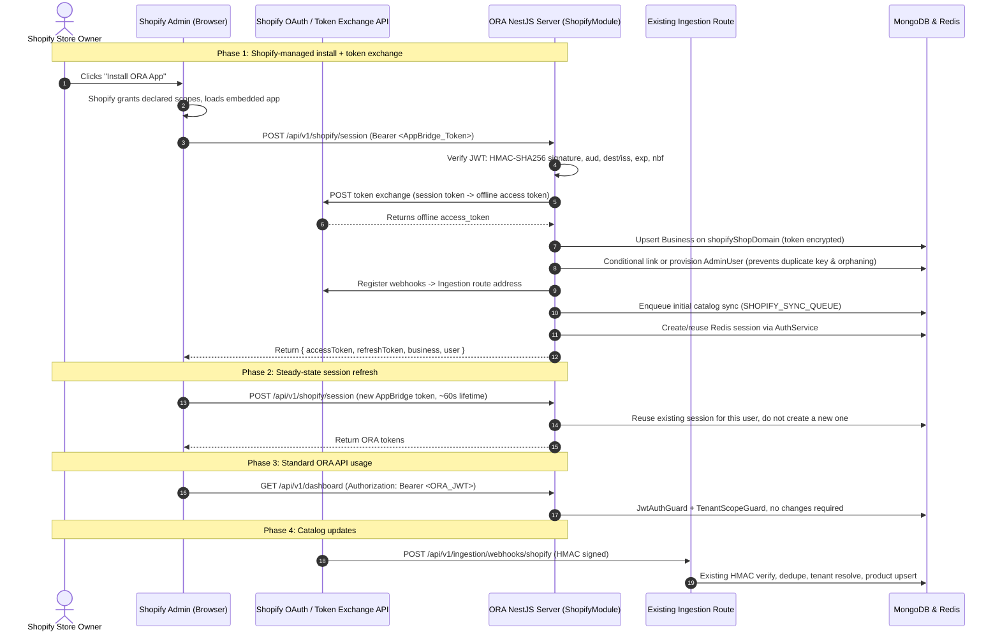

# Shopify Embedded App Integration & Authentication Bridge — Final Plan (Revision 3)

This document is the implementation plan for serving an **Embedded Shopify App** from ORA's existing NestJS backend.

Revision 3. It folds in the codebase review and the settled decisions:
- **Shopify API Version:** `2026-07` (replacing sunset `2024-01`).
- **Account-Linking Semantics:** Conditional linking with store-scoped alias fallback (no silent repointing, no tenant orphaning).
- **Embedded Frontend:** Dedicated `packages/shopify-app/` package.
- **Primary Install:** Token Exchange (`urn:ietf:params:oauth:grant-type:token-exchange`).
- **Billing:** `BillingProvider.SHOPIFY` in `BillingModule` implementing `server/src/billing/providers/payment-provider.interface.ts`.

---

## 1. Goals

1. Merchants install the ORA app from the Shopify App Store in one click.
2. The server handles installation, token acquisition, webhook registration, tenant auto-provisioning, and initial catalog ingestion.
3. The embedded frontend inside Shopify Admin exchanges a Shopify App Bridge session token for a standard ORA JWT via `POST /api/v1/shopify/session`, so existing ORA APIs (`/products`, `/agent-config`, `/dashboard`, `/conversations`) work unchanged.
4. Merchants never copy-paste a secret API key or edit theme code by hand.

Goal 3 is confirmed achievable without touching the existing guards. `JwtStrategy.validate` (`server/src/auth/strategies/jwt.strategy.ts:32`) requires only a live Redis session keyed by `sessionId`. Any code path that creates that session produces tokens every existing guard accepts.

---

## 2. Settled Decisions

### 1. Current Shopify API Version: `2026-07`
Shopify's latest stable quarterly release is `2026-07`. The sunset `2024-01` at `server/src/ingestion/services/shopify-connector.service.ts:197` will be replaced with a constant:
```typescript
export const SHOPIFY_API_VERSION = '2026-07';
```

### 2. Account-Linking Semantics: Conditional Linking
To prevent silent repointing (which orphans tenants and causes data loss) while avoiding premature platform-wide multi-membership refactoring:
- **If the user's business is unbound (web signup first):** Link directly to this Shopify store (`business.shopifyShopDomain = shopDomain`).
- **If the user already owns another active business:** Do not repoint. Provision a store-scoped `AdminUser` identity (`shopify+<shop>@ora.internal`) attached exclusively to the new `Business`. The merchant operates Store B inside Shopify Admin via Shopify SSO without corrupting Store A.

### 3. Dedicated Workspace Package: `packages/shopify-app/`
The embedded app lives in `packages/shopify-app/`. It keeps iframe framing headers (`frame-ancestors https://admin.shopify.com`) isolated from the main dashboard (`client/`), avoiding clickjacking vulnerabilities.

### 4. Billing Provider: `BillingProvider.SHOPIFY`
Implemented in `server/src/billing/providers/shopify.provider.ts` implementing `server/src/billing/providers/payment-provider.interface.ts`. Shopify merchants subscribe through Shopify App Billing (`appSubscriptionCreate`); VPS web merchants continue on Stripe/bKash.

---

## 3. Architecture & Token Flow



---

## 4. Proposed Changes

### Backend — Shopify module (`server/src/shopify/`)

#### [NEW] `server/src/shopify/shopify.module.ts`
Imports `MongooseModule` for `Business` and `AdminUser`, plus `ConfigModule`, `RedisModule`, `AuthModule`, `UsersModule`, `BillingModule`, and `IngestionModule`. Registers `SHOPIFY_SYNC_QUEUE` through `BullModule.registerQueue`. Exports `ShopifyService`.

#### [NEW] `server/src/shopify/shopify.controller.ts`
1. `POST /api/v1/shopify/session` — primary endpoint. Accepts the App Bridge session token as `Authorization: Bearer <token>`. On first call for a shop: performs token exchange, provisions tenant, registers webhooks, enqueues catalog sync. On later calls: reuses session and returns ORA tokens.
2. `GET /api/v1/shopify/auth` — optional fallback for direct browser installs.
3. `GET /api/v1/shopify/callback` — optional fallback callback (uses raw query parsing).
4. `POST /api/v1/shopify/billing/subscribe` — calls `BillingService` for Shopify recurring subscriptions.
5. `GET /api/v1/shopify/billing/callback` — confirms charge status and activates plan.
6. `POST /api/v1/shopify/webhooks/compliance/:topic` — handles the 3 mandatory GDPR compliance webhooks (`customers/data_request`, `customers/redact`, `shop/redact`).

#### [NEW] `server/src/shopify/shopify.service.ts`
- `verifySessionToken(token)` — validates App Bridge JWT: HS256 signature with `SHOPIFY_API_SECRET`, `aud === SHOPIFY_API_KEY`, agreement between `dest` and `iss` hosts, `exp`, `nbf`, and clock skew.
- `exchangeSessionToken(shop, sessionToken)` — IETF token exchange grant for offline access token.
- `fetchShopDetails(shop, accessToken)` — store metadata for provisioning.
- `provisionTenant(shopDetails, accessToken)` — upsert `Business`, conditional account linking, token encryption.
- `registerWebhooks(shop, accessToken)` — subscribes topics, pointing at `/api/v1/ingestion/webhooks/shopify`.
- `handleUninstall(shop)` — clears credentials, cancels subscription, sets `status: 'suspended'`.

#### [NEW] `server/src/shopify/shopify.constants.ts`
- `SHOPIFY_API_VERSION = '2026-07'`
- `SHOPIFY_SYNC_QUEUE = 'shopify-catalog-sync'`
- Required scopes, error codes.

#### [NEW] `server/src/shopify/shopify-sync.processor.ts`
BullMQ worker for `SHOPIFY_SYNC_QUEUE`. Does an authenticated, cursor-paginated walk of Shopify GraphQL/REST Admin API, writing through `ProductsService.batchSync()` for automated vector embedding.

---

### Cross-Cutting Server Updates

#### [MODIFY] `server/src/users/schemas/business.schema.ts`
Add indexed unique field:
```typescript
@Prop({ type: String, unique: true, sparse: true, index: true, trim: true })
shopifyShopDomain?: string;

@Prop() shopifyInstalledAt?: Date;
@Prop() shopifyUninstalledAt?: Date;
@Prop({ type: [String], default: [] }) shopifyScopes?: string[];
```

#### [MODIFY] `server/src/auth/auth.service.ts`
Add `issueSessionForUser(userId, businessId, email, role, reqInfo)` that wraps token generation and reuses active Redis sessions for the store/user.

#### [MODIFY] `server/src/ingestion/services/shopify-connector.service.ts`
- Replace hardcoded `2024-01` at line 197 with `SHOPIFY_API_VERSION`.
- Add `app/uninstalled` topic handling in `processWebhook()`.

#### [MODIFY] `server/src/billing/schemas/subscription.schema.ts` & `server/src/billing/providers/`
- Add `SHOPIFY = 'shopify'` to `BillingProvider`.
- [NEW] `server/src/billing/providers/shopify.provider.ts` implementing `server/src/billing/providers/payment-provider.interface.ts`.

#### [MODIFY] `server/src/main.ts`
Add CSP header: `Content-Security-Policy: frame-ancestors https://*.myshopify.com https://admin.shopify.com;`.

#### [MODIFY] `server/src/app.module.ts`
Register `ShopifyModule` in the root `imports` array.

#### [MODIFY] `server/.env.example`
Add Shopify partner credentials (`SHOPIFY_API_KEY`, `SHOPIFY_API_SECRET`, `SHOPIFY_SCOPES`, `SHOPIFY_APP_URL`).

---

## 5. Suggested Implementation Order

1. Schema & constants setup (`shopifyShopDomain`, `SHOPIFY_API_VERSION = '2026-07'`, update line 197, `.env.example`).
2. `AuthService.issueSessionForUser` with Redis session reuse.
3. `ShopifyService.verifySessionToken` with full claim verification.
4. Token exchange and `provisionTenant` with conditional account-linking logic.
5. CSP framing header and `POST /api/v1/shopify/session` endpoint.
6. Webhook registration pointing to existing ingestion route, plus `app/uninstalled` handler.
7. GDPR compliance webhooks.
8. `SHOPIFY_SYNC_QUEUE` and catalog sync processor.
9. Shopify billing provider in `BillingModule`.
10. Fallback OAuth redirect endpoints (optional scope).
