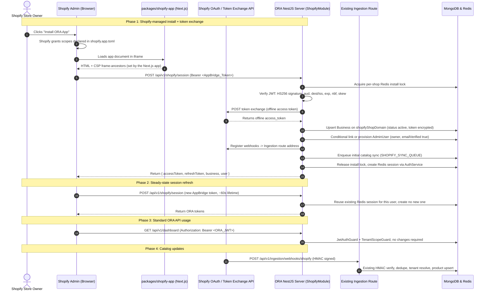

# Shopify Embedded App Integration & Authentication Bridge — Final Plan (Revision 4)

> [!NOTE]
> **Implemented on 2026-09-10.** See `docs/shopify-embedded-app-implementation.md` for what was built, what deviated from this plan, and what is left. This document is kept as the design record.

This document is the implementation plan for serving an **Embedded Shopify App** from ORA's existing NestJS backend.

Revision 4 keeps Revision 3's four settled decisions and restores the codebase-verified detail that Revision 3 condensed away. Every file and line reference below was checked against commit `25f217d`.

Settled decisions carried forward:
- **Account-Linking Semantics:** conditional linking with a store-scoped alias fallback — no silent repointing, no tenant orphaning.
- **Embedded Frontend:** dedicated `packages/shopify-app/` package.
- **Primary Install:** token exchange (`urn:ietf:params:oauth:grant-type:token-exchange`).
- **Billing:** `BillingProvider.SHOPIFY` in `BillingModule`, implementing `server/src/billing/providers/payment-provider.interface.ts`.

One Revision 3 decision is demoted, in section 2.1: the Shopify API version is a pre-merge check rather than a settled value.

---

## 1. Goals

1. Merchants install the ORA app from the Shopify App Store in one click.
2. The server handles installation, token acquisition, webhook registration, tenant auto-provisioning, and initial catalog ingestion.
3. The embedded frontend inside Shopify Admin exchanges a Shopify App Bridge session token for a standard ORA JWT via `POST /api/v1/shopify/session`, so existing ORA APIs (`/products`, `/agent-config`, `/dashboard`, `/conversations`) work unchanged.
4. Merchants never copy-paste a secret API key or edit theme code by hand.

Goal 3 is confirmed achievable without touching the existing guards. `JwtStrategy.validate` (`server/src/auth/strategies/jwt.strategy.ts:32`) requires only a live Redis session keyed by `sessionId`. Any code path that creates that session produces tokens every existing guard accepts.

---

## 2. Settled Decisions

### 2.1 Shopify API version — pre-merge check, not a settled value

Replace the hardcoded `2024-01` at `server/src/ingestion/services/shopify-connector.service.ts:197` with a single constant in `shopify.constants.ts`:

```typescript
export const SHOPIFY_API_VERSION = '<current stable>';
```

> [!IMPORTANT]
> Confirm the current stable version against Shopify's release notes before merging. Shopify ships quarterly and supports roughly one year of versions. `2024-01` is definitively sunset; the replacement value must be read from Shopify's own documentation at implementation time rather than assumed.

### 2.2 Account-linking semantics — conditional linking

`AdminUser.email` is globally unique and `passwordHash` is required (`server/src/users/schemas/admin-user.schema.ts`), and every web signup already creates its own `Business` (`server/src/auth/auth.service.ts:100-108`). So a merchant who signed up on the web and then installs from Shopify has an existing user *and* an existing business. Three cases:

1. **No ORA account for this email.** Provision a new `Business` and a new `AdminUser` bound to it.
2. **Existing account whose business is free to bind.** Link it: set `business.shopifyShopDomain = shopDomain`. "Free to bind" means both `shopifyShopDomain` is unset **and** `connectedPlatform === 'none'`. The second condition matters: a business already on `'woocommerce'`, `'feed'`, or `'manual'` has a live catalog source, and linking would silently switch it.
3. **Existing account whose business is already bound or already connected to another platform.** Do not repoint. Provision a new `Business` for the Shopify store, plus a store-scoped `AdminUser` identity `shopify+<normalized-shop>@ora.internal` attached only to that new business. The merchant operates the second store from inside Shopify Admin through Shopify SSO, with the first store untouched.

Normalize the shop domain to lowercase before building the alias — `AdminUser.email` is declared `lowercase: true`, so an unnormalized alias would collide inconsistently.

The alias address receives no mail and has no usable password. Therefore the **real owner email from Shopify's shop payload must be stored on the `Business`** and used for billing and invoice delivery. The alias is a login identity only. Without this, a store provisioned through case 3 has no reachable contact address.

### 2.3 Dedicated workspace package — `packages/shopify-app/`

`pnpm-workspace.yaml` already globs `packages/*`, and the directory does not exist yet, so this is a clean addition. The reason for a separate package is framing policy: the embedded app must be framable by Shopify Admin, while `client/` must not be framable at all. See section 5.1 — that split is the whole point, and it does not work if both live in one Next.js app.

### 2.4 Billing provider — `BillingProvider.SHOPIFY`

Implemented as `server/src/billing/providers/shopify.provider.ts` against the existing `payment-provider.interface.ts`. Shopify merchants subscribe through Shopify App Billing (`appSubscriptionCreate`); direct VPS merchants continue on Stripe and bKash. Keeping `Subscription` as the single source of truth means `server/src/billing/services/billing-scheduler.service.ts` continues to see Shopify tenants.

---

## 3. Architecture & Token Flow



---

## 4. Proposed Changes — Backend

### 4.1 [NEW] `server/src/shopify/shopify.module.ts`

Imports `MongooseModule` for `Business` and `AdminUser`, plus `ConfigModule`, `RedisModule`, `AuthModule`, `UsersModule`, `BillingModule`, and `IngestionModule`. Registers `SHOPIFY_SYNC_QUEUE` through `BullModule.registerQueue`. Exports `ShopifyService`.

`IngestionModule` already exports `ShopifyConnectorService` (`server/src/ingestion/ingestion.module.ts:61`), so the sync processor can reuse the existing upsert path.

### 4.2 [NEW] `server/src/shopify/shopify.controller.ts`

1. `POST /api/v1/shopify/session` — the primary endpoint. Accepts the App Bridge session token as `Authorization: Bearer <token>`. On the first call for a shop it performs token exchange, provisions the tenant, registers webhooks, and enqueues the catalog sync, all under the install lock from section 4.7. On later calls it only issues ORA tokens.
2. `GET /api/v1/shopify/auth` — optional fallback for non-embedded browser installs. Generates a nonce, stores it in Redis, redirects to Shopify's authorize URL.
3. `GET /api/v1/shopify/callback` — optional fallback callback. See section 5.4 for the two constraints this route must satisfy.
4. `POST /api/v1/shopify/billing/subscribe` — thin delegate to `BillingService`.
5. `GET /api/v1/shopify/billing/callback` — confirms charge status, activates the plan.
6. `POST /api/v1/shopify/webhooks/compliance/:topic` — the three mandatory GDPR topics. See section 5.5.

Every redirecting endpoint (2, 3, and 5) must use `@Res()` passthrough. `TransformInterceptor` is registered globally (`server/src/main.ts:23`) and would otherwise wrap the redirect response.

### 4.3 [NEW] `server/src/shopify/shopify.service.ts`

- `verifySessionToken(token)` — validates the App Bridge JWT. Check **all** of: HS256 signature against `SHOPIFY_API_SECRET`, `aud === SHOPIFY_API_KEY`, agreement between the `dest` and `iss` hosts, `exp`, `nbf`, and a small clock-skew allowance. A signature check alone would let a token minted for a different app under the same Partner account authenticate here.
- `exchangeSessionToken(shop, sessionToken)` — the IETF token exchange grant, requesting an offline access token.
- `fetchShopDetails(shop, accessToken)` — store metadata for provisioning, including the owner email required by section 2.2.
- `provisionTenant(shopDetails, accessToken)` — see section 4.6 for the field-level requirements.
- `registerWebhooks(shop, accessToken)` — subscribes topics pointing at `/api/v1/ingestion/webhooks/shopify`.
- `handleUninstall(shop)` — clears `shopifyAccessToken`, cancels the Shopify subscription, sets `status: 'suspended'` (a valid value of the enum at `server/src/users/schemas/business.schema.ts:91`), stamps `shopifyUninstalledAt`.
- `verifyHmac(rawQueryString)` — fallback flow only.

Write the access token through `BusinessCredentialsUtil.protect()` and read it back through `BusinessCredentialsUtil.reveal()` (`server/src/common/utils/business-credentials.util.ts`), matching the contract documented at `business.schema.ts:110`. Never read the raw field. (Revision 4 named a `shopifyAccessToken()` helper; the util's actual methods are `protect` and `reveal`.)

### 4.4 [NEW] `server/src/shopify/shopify.constants.ts`

`SHOPIFY_API_VERSION` (section 2.1), `SHOPIFY_SYNC_QUEUE = 'shopify-catalog-sync'`, the required scope list, the install-lock key prefix, and error codes.

### 4.5 [NEW] `server/src/shopify/shopify-sync.processor.ts`

BullMQ worker for `SHOPIFY_SYNC_QUEUE`, doing an authenticated cursor-paginated walk of the Admin API with backoff on Shopify's 429 responses.

**It must not assume `batchSync` embeds anything.** `ProductsService.batchSync` (`server/src/products/products.service.ts:359-383`) does a Mongo `bulkWrite` and then `invalidateRagCache` — nothing more. Vector embedding is a separate explicit step, and the existing webhook path does it one product at a time: `findOne` for the saved document, then `vectorStoreService.upsertVector` (`server/src/ingestion/services/shopify-connector.service.ts:125-147`).

Copying that per-product shape into a full catalog walk means one extra `findOne` and one embedding call per product, which is the wrong cost profile for an initial import of thousands of items. The processor needs a batched path: `batchSync` a page, read the saved documents back in one query, then embed in bulk.

Only the queue is new — `HTML_CRAWL_QUEUE` (`server/src/ingestion/ingestion.module.ts:33`) is the only registered queue today, and no authenticated Shopify catalog importer exists. `platform-fast-path.service.ts:24` reads the unauthenticated public storefront `/products.json`, and `searchProductsLive` fetches at most 5 items.

### 4.6 Provisioning — explicit field requirements

The existing helpers hardcode values that are wrong for this flow:

- `UsersService.createBusiness` hardcodes `status: 'pending'` (`server/src/users/users.service.ts:79`)
- `UsersService.createAdminUser` hardcodes `emailVerified: false` (`:98`) and defaults `role` to `AdminRole.USER` (`:97`)

Neither accepts an override. Reusing them as-is produces a `pending` tenant whose API calls fail immediately, owned by an unverified user whose billing emails are queued per `server/AGENTS.md` section 2.1.

`provisionTenant` must therefore set, explicitly:

| Field | Value | Reason |
|---|---|---|
| `Business.status` | `'active'` | The default `'pending'` breaks every API call. |
| `Business.connectedPlatform` | `'shopify'` | Drives the RAG live-fallback connector choice. |
| `Business.shopifyShopDomain` | normalized `store.myshopify.com` | The unique upsert key; see section 4.7. |
| `Business.shopifyInstalledAt` | now | Install lifecycle. |
| `Business.shopifyScopes` | granted scopes | Consumed by the scope-change check below. |
| `AdminUser.role` | `AdminRole.OWNER` | `register` defaults to `USER`; a store owner is not a `USER`. |
| `AdminUser.emailVerified` | `true` | Shopify has verified the address; otherwise invoices queue. |
| `AdminUser.passwordHash` | random, high-entropy | Required by the schema. Web login then requires the forgot-password flow — document this. |

Either extend `createBusiness` and `createAdminUser` to accept these, or write the models directly in `ShopifyService`. Extending the helpers is preferable, since a second creation path will drift.

**Scope changes.** `shopifyScopes` is only worth storing if something reads it. On each `POST /shopify/session`, compare the granted scopes in the session token against the stored set; on a mismatch, re-run token exchange and update the record. If that check is not implemented, drop the field rather than leaving it dead.

### 4.7 Install idempotency

Provisioning runs inside `POST /api/v1/shopify/session`, which the embedded client calls on **every** page load, because App Bridge tokens live about 60 seconds. Two concurrent loads would otherwise both run token exchange, both register webhooks, and both enqueue a sync.

The unique index on `shopifyShopDomain` protects the `Business` row only. Take a per-shop Redis lock around the whole first-install path, with a short TTL, and treat a failure to acquire it as "another request is provisioning" rather than an error.

### 4.8 [MODIFY] `server/src/users/schemas/business.schema.ts`

```typescript
@Prop({ type: String, unique: true, sparse: true, index: true, trim: true, lowercase: true })
shopifyShopDomain?: string;

@Prop() shopifyInstalledAt?: Date;
@Prop() shopifyUninstalledAt?: Date;
@Prop({ type: [String], default: [] }) shopifyScopes?: string[];
@Prop({ trim: true }) shopifyOwnerEmail?: string;
```

The existing `shopifyStoreUrl` is a plain `@Prop({ trim: true })` (`:107`) — neither unique nor indexed — which is why the current webhook tenant lookup runs an unindexed `$or` across three URL shapes (`server/src/ingestion/ingestion.controller.ts:118-124`).

Once `shopifyShopDomain` is populated, **narrow that lookup to the indexed field.** This was the payoff for adding it. Keep the `$or` fallback only for tenants provisioned before this change, and remove it after a backfill.

### 4.9 [MODIFY] `server/src/auth/auth.service.ts`

Add a public `issueSessionForUser(userId, businessId, email, role, reqInfo)` wrapping the existing private `generateTokens` (`:758`) and the Redis session write.

`ShopifyService` cannot call `generateTokens` because it is private, and must not reimplement it: the refresh token is an opaque 32-byte hex value whose bcrypt hash lives in the Redis session (`:281-295`), and a second copy of that logic will drift from `refresh` and `logout`.

The method must **reuse** an active session for the user rather than always creating one. `RedisService.setSession` defaults to a 7-day TTL (`server/src/common/redis/redis.service.ts:46`) while the client re-exchanges every page load, so a fresh session per exchange grows Redis without bound for every active shop.

### 4.10 [MODIFY] `server/src/ingestion/services/shopify-connector.service.ts`

- Replace the hardcoded `2024-01` at `:197` with `SHOPIFY_API_VERSION`.
- Add an `app/uninstalled` case to the `processWebhook` switch (`:80-93`), delegating to `ShopifyService.handleUninstall`. The topic currently falls through to `default`, which only logs `Unhandled topic`.

### 4.11 [MODIFY] `server/src/billing/`

- `schemas/subscription.schema.ts` — add `SHOPIFY = 'shopify'` to `BillingProvider`, which today holds only `STRIPE` and `BKASH` (`:7`).
- [NEW] `providers/shopify.provider.ts` — implements `payment-provider.interface.ts` and calls `appSubscriptionCreate`.

### 4.12 [MODIFY] `server/src/app.module.ts` and `server/.env.example`

Register `ShopifyModule` in the root `imports` array. Add `SHOPIFY_API_KEY`, `SHOPIFY_SCOPES`, and `SHOPIFY_APP_URL` to `.env.example`.

`SHOPIFY_API_SECRET` is already read by the webhook verifier (`shopify-connector.service.ts:30`), which correctly fails every verification when unset rather than falling back to a guessable secret. The same variable now also verifies App Bridge session tokens.

---

## 5. Security Requirements

Each item blocks either correct operation or App Store approval.

### 5.1 The framing header belongs to the Next.js app, not the API

`Content-Security-Policy: frame-ancestors` is enforced by the browser on the **framed document**. The ORA NestJS server serves no documents: there is no `ServeStaticModule`, `useStaticAssets`, or `sendFile` anywhere in `server/src`, and it runs API-only under the `api/v1` prefix. **Setting `frame-ancestors` in `server/src/main.ts` would have no effect on whether Shopify Admin can frame the app.**

The header must come from whatever serves the embedded app's HTML, which is `packages/shopify-app/`. Set it in that package's `next.config.ts` `headers()`.

Prefer the **specific shop domain** over a wildcard. `frame-ancestors https://*.myshopify.com` does work, but it permits any Shopify store to frame a given merchant's app instance; Shopify's own pattern names the requesting shop. Derive it per-request from the `shop` parameter and fall back to refusing.

Separately, `client/` must be **non**-framable. `client/next.config.ts` already exports a `headers()` function (currently only CORS headers for `/widget/:path*` and `/audio-processors/:path*`), so add `frame-ancestors 'none'` there for the dashboard routes. Do not apply a blanket CSP across `/widget/:path*` — that path is deliberately cross-origin loadable by merchant storefronts.

### 5.2 Session token claim validation

As specified in section 4.3 — validate every claim, not just the signature.

### 5.3 The OAuth nonce must live in Redis

For the fallback flow, store the `state` nonce in Redis keyed by shop, with a short TTL, deleted on first use so it cannot be replayed. Do not use a cookie: the embedded app runs in a third-party iframe context where the cookie is unreliable or blocked outright.

### 5.4 The fallback callback has two hard constraints

If the fallback flow is implemented at all, its callback must satisfy both:

1. **HMAC over the raw query string.** Nest's parsed `@Query()` object reorders and percent-decodes values, so it cannot reproduce the bytes Shopify signed. Read from `req.originalUrl`.
2. **A per-route override of the global `ValidationPipe`.** `server/src/main.ts:17-21` configures `whitelist: true, forbidNonWhitelisted: true` globally. Shopify sends `code`, `hmac`, `host`, `shop`, `state`, and `timestamp`, and adds parameters over time; any unlisted parameter returns `400`. Whitelisting also strips parameters the HMAC was computed over, so the signature would fail even if the request were accepted.

Token exchange avoids both problems, which is why it is the primary path.

### 5.5 GDPR mandatory webhooks

Shopify requires `customers/data_request`, `customers/redact`, and `shop/redact` for App Store listing. Each must verify the HMAC before acting. These are not stubs:

- `customers/data_request` — return the stored data for the identified customer.
- `customers/redact` — delete that customer's records, including conversations.
- `shop/redact` — delete the merchant's ingested catalog, knowledge base, conversations, and vector entries for that `businessId`.

### 5.6 Pre-existing issue, tracked separately

`server/src/main.ts:27-30` configures CORS as `origin: (origin, callback) => callback(null, true)` with `credentials: true`, reflecting any origin with credentials attached. This predates the Shopify work and belongs on the `fix/credential-auth-hardening` branch, but the embedded app should not ship on top of it.

---

## 6. Proposed Changes — Embedded Frontend (`packages/shopify-app/`)

The package does not exist and must be created. Minimum contents:

- `package.json` — workspace member named `shopify-app`; picked up by the existing `packages/*` glob.
- `shopify.app.toml` — **required.** Shopify-managed installation reads the declared scopes from this file. Without it, token exchange has nothing to grant. Holds the app handle, `application_url`, and the scope list, which must agree with `SHOPIFY_SCOPES`.
- `next.config.ts` — the `frame-ancestors` header from section 5.1.
- App Bridge bootstrap — loads Shopify App Bridge in the document head, as Shopify requires for embedded apps.
- A session-token fetch wrapper — calls `POST /api/v1/shopify/session`, caches the resulting ORA `accessToken` in memory, retries once on `401` with a fresh App Bridge token. It must **unwrap the response envelope**, since `TransformInterceptor` wraps every ORA response as `{ success: true, data }`.

Reuse the shape of `client/lib/api-client.ts` for the wrapper rather than inventing a second client contract.

---

## 7. Verification Plan

### 7.1 Unit tests

`ShopifyService.verifySessionToken`:
- Accepts a token with every claim valid.
- **Rejects** a validly signed token whose `aud` does not match `SHOPIFY_API_KEY`.
- **Rejects** a token replayed after `exp`.
- **Rejects** a token whose `dest` and `iss` hosts disagree.
- **Rejects** a token failing signature verification.

Provisioning:
- A newly provisioned `Business` has `status: 'active'` and `connectedPlatform: 'shopify'`.
- A newly provisioned `AdminUser` has `role: AdminRole.OWNER` and `emailVerified: true`.
- Installing the same shop twice updates one `Business` and creates no duplicate tenant.
- Installing with an email that already has an ORA account produces the section 2.2 case-2 or case-3 outcome, and never `E11000`.
- A business already on `connectedPlatform: 'woocommerce'` is **not** relinked (case 3, not case 2).
- Two concurrent first-install requests for one shop register webhooks once.

Webhooks:
- `app/uninstalled` clears the stored access token and stamps `shopifyUninstalledAt`.
- Each compliance topic verifies its HMAC and is handled, not logged as unhandled.
- `shop/redact` removes catalog, knowledge, conversation, and vector records for the `businessId`.

Fallback flow, if implemented:
- A callback carrying an unexpected extra query parameter succeeds rather than returning `400`.
- A replayed nonce is rejected.

Run with:

```bash
pnpm --filter server test shopify
```

Note there is no root `package.json`; a bare `pnpm test` fails with `ERR_PNPM_NO_IMPORTER_MANIFEST_FOUND`. The baseline before this work is 43 suites and 224 tests passing.

### 7.2 Integration verification

1. Exchange a simulated App Bridge JWT at `POST /api/v1/shopify/session`; confirm ORA tokens come back.
2. Confirm the returned `accessToken` authenticates against `GET /api/v1/dashboard`, `GET /api/v1/agent-config`, and `GET /api/v1/products`.
3. Confirm repeated session exchanges for one user do not accumulate Redis sessions.
4. Confirm the app loads inside Shopify Admin — this is the only real test of the section 5.1 header, and it must be checked from the embedded frontend's own response, not the API's.
5. Confirm `client/`'s dashboard routes refuse to be framed.
6. Confirm a product edit in Shopify Admin reaches ORA through the existing ingestion webhook route.
7. Confirm an initial sync of a catalog with more than 1,000 products completes, and measure the embedding call count against the product count.

---

## 8. Implementation Order

Each step leaves the tree working and testable.

1. Schema and constants: the section 4.8 fields, `SHOPIFY_API_VERSION` (with the version confirmed per section 2.1), replacing line 197, and `.env.example`.
2. `AuthService.issueSessionForUser`, with session reuse and tests, independent of Shopify.
3. `ShopifyService.verifySessionToken`, with the full claim-validation test set.
4. Create `packages/shopify-app/` with `shopify.app.toml`, the framing header, and the App Bridge bootstrap.
5. Token exchange plus `provisionTenant`, including the section 4.6 field requirements and the section 4.7 install lock.
6. `POST /api/v1/shopify/session` end to end, then the section 7.2 step 4 framing check.
7. Webhook registration pointed at the existing ingestion route, plus the `app/uninstalled` handler.
8. The GDPR compliance webhook endpoints.
9. `SHOPIFY_SYNC_QUEUE` and the catalog sync processor, with the batched embedding path from section 4.5.
10. Narrow the ingestion webhook tenant lookup to `shopifyShopDomain` and backfill.
11. The Shopify billing provider in `BillingModule`.
12. Optional: the fallback OAuth redirect endpoints, with the section 5.4 constraints.
