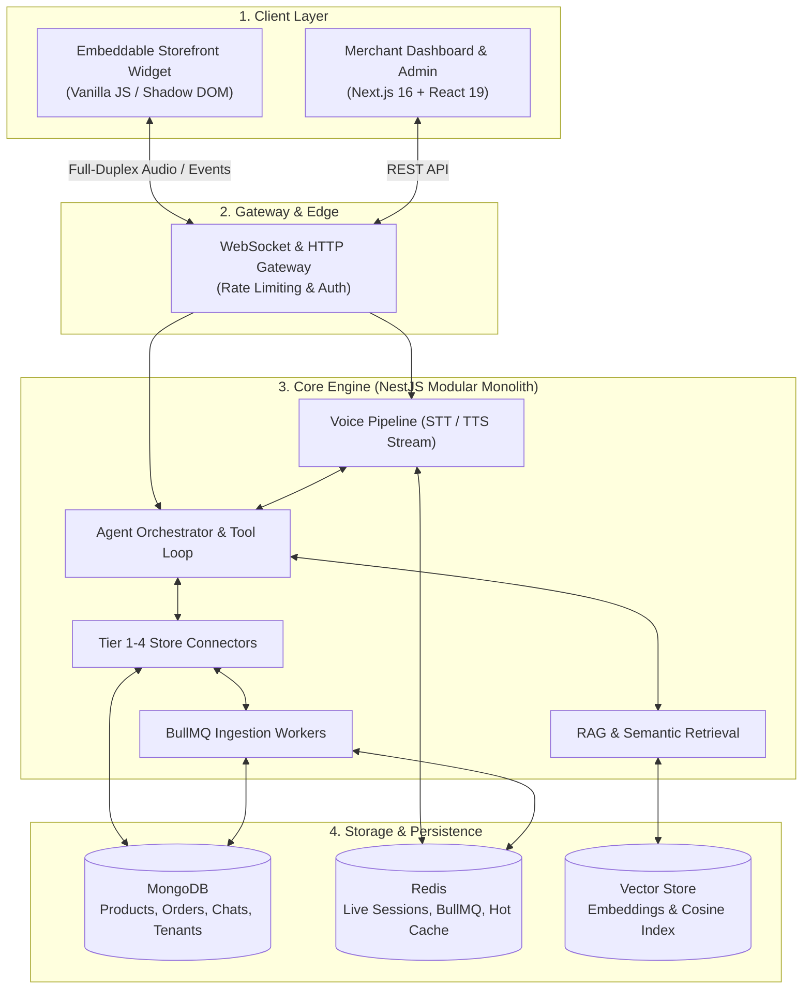
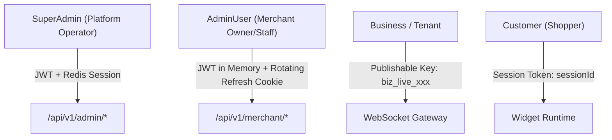

# ORA — Complete System Architecture & Design Patterns

## 1. System Overview

ORA is a multi-tenant, voice-first AI sales agent for e-commerce stores (Shopify, WooCommerce). It operates as a single `<script>` tag embedded on merchant storefronts, providing real-time voice and text conversational commerce.



---

## 2. Core System Design Patterns Applied

### Pattern 1: Modular Monolith
* **Why chosen:** Microservices introduce excessive network latency, distributed transaction complexity, and deployment overhead for a real-time voice pipeline.
* **Implementation:** Built with **NestJS** divided into decoupled domain modules (`ai-voice`, `rag`, `shopify`, `billing`, `gateway`). Modules communicate via internal providers and BullMQ event queues.

### Pattern 2: Multi-Tenant Logical Isolation (Shared DB / Shared Process)
* **Why chosen:** Dedicated databases per tenant create extreme connection pooling overhead and scale limits.
* **Implementation:** All collections share database tables. Isolation is strictly enforced at application runtime:
  - Every schema has an indexed `businessId`.
  - Every repository query enforces `{ businessId }`.
  - The `TenantScopeGuard` validates tenant context before execution.

### Pattern 3: Full-Duplex Real-Time Streaming Gateway
* **Why chosen:** Turn-based HTTP polling creates unusable latency for voice conversations.
* **Implementation:** WebSockets establish persistent, bi-directional audio streams. As the shopper speaks, raw audio chunks stream to Speech-to-Text (STT) without waiting for full utterance completion.

### Pattern 4: Hybrid RAG with Live Anti-Hallucination Verification
* **Why chosen:** Vector databases cannot track real-time stock levels or sudden price updates. LLMs hallucinate stock status if relying solely on embeddings.
* **Implementation (Two-Tier Retrieval):**
  1. **Semantic Search:** Vector embeddings fetch the top 5 candidate products matching customer intent.
  2. **Live Verification (Mode A/B):** The engine executes parallel live API calls to Shopify to confirm current price, variants, and stock before the AI generates an answer.

### Pattern 5: Asynchronous Event-Driven Ingestion (Worker Queue Pattern)
* **Why chosen:** Syncing thousands of products from e-commerce catalogs or crawling URLs blocks the API thread.
* **Implementation:** **BullMQ on Redis**. When a merchant connects Shopify or triggers a sync:
  - Jobs are distributed across isolated tenant queues.
  - Workers parse products, chunk metadata, compute embeddings, and bulk-write to MongoDB.

---

## 3. The 4 System Actors & Security Matrix



1. **SuperAdmin:** Root platform operator accessing platform analytics and tenant management.
2. **AdminUser:** Merchant owner and staff members. Uses rotating refresh tokens stored in `httpOnly`, `Secure` cookies with session revocation in Redis.
3. **Business (Tenant):** The merchant account itself. Authorizes widget WebSocket connections using a public key (`biz_live_...`). Store API secrets (Shopify tokens) are stored server-side encrypted (AES-256).
4. **Customer:** End-shopper. Has **no password or account**. Identified solely by ephemeral conversation `sessionId`.

---

## 4. End-to-End Query-Time Flow

```
[1. Shopper Spoken Utterance]
             │
             ▼
[2. WebSocket Gateway] ── (Rate-limit check + Authenticate 'biz_live_...')
             │
             ▼
[3. Voice Pipeline] ── (Streaming STT converts voice chunks to text)
             │
             ▼
[4. RAG Vector Search] ── (Cosine similarity search scoped by businessId)
             │
             ├── Found: Top 5 candidates selected
             └── Not Found: Fallback to keyword text search / live Shopify query
             │
             ▼
[5. Live Inventory Check] ── (Parallel API calls to Shopify verify stock & price)
             │
             ▼
[6. Agent Tool Loop] ── (LLM plans action: recommend, compare, or add-to-cart)
             │
             ▼
[7. TTS Stream & UI Action] ── (Audio streamed to speaker + Product Card sent to DOM)
```

---

## 5. Storage & Database Schema Strategy

| Store | Technology | Purpose | Retention |
|---|---|---|---|
| **Primary Store** | MongoDB | Products, Orders, Conversations, Tenants, Invoices | Persistent |
| **Session Cache** | Redis | Ephemeral session state, idle timers, cart cache | 10s–24h TTL |
| **Queue Broker** | Redis + BullMQ | Webhook processing, catalog ingestion, email jobs | Cleared on completion |
| **Vector Store** | Mongo Vector Index | High-dimensional product and knowledge embeddings | Synced with catalog |

---

## 6. Tiered Data Source Architecture

ORA connects to merchant catalogs via 4 distinct tiers:

1. **Tier 1 (Direct Platform Connectors):** Shopify, WooCommerce. Real-time webhooks, live cart manipulation, instant order placement (Confidence: 1.0).
2. **Tier 2 (Product Feeds):** Google Merchant Center / Meta catalog feeds. Periodic polling, search/recommendation only (Confidence: 0.7).
3. **Tier 3 (Passive Crawl):** JSON-LD / OpenGraph scrapers. Answers page-level questions (Confidence: 0.3).
4. **Tier 4 (Custom Endpoints):** Merchant-provided REST APIs (Confidence: 0.5–1.0).
